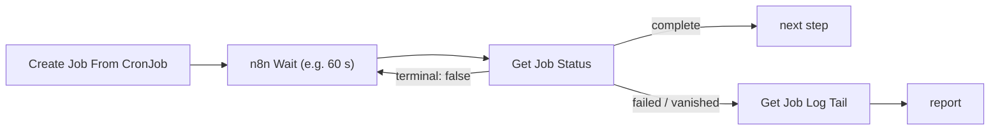

# n8n-nodes-k8s (fork)

An n8n node for one job: **start a Kubernetes Job from a suspended CronJob template, then check on it**, from an n8n workflow that waits between checks with n8n's own Wait node.

It is a fork of [`chaosimpact/n8n-nodes-k8s`](https://github.com/chaosimpact/n8n-nodes-k8s) 0.2.0 (MIT), cut down to the calls that use case needs and rebuilt around a narrow service account. The general-purpose operations of upstream (create/patch/delete any resource, run pods, wait on watches) are gone.

## Operations

| Operation | API calls | Output |
|---|---|---|
| **Create Job From CronJob** | `GET cronjobs/<name>`, `POST jobs` | `name`, `namespace`, `uid`, `cronJob`, `suspended` |
| **Get Job Status** | `GET jobs/<name>` | `state`: `running` / `suspended` / `complete` / `failed` / `vanished`, `terminal`, `reason`, `message`, counts, times |
| **Get Job Log Tail** | `GET pods?labelSelector=batch.kubernetes.io/job-name=<job>`, `GET pods/<newest>/log` | `found`, `pod`, `phase`, `container`, `log` |

- **Create** builds a plain Job from the CronJob's `.spec.jobTemplate`. Unlike `kubectl create job --from=cronjob/…`, it never writes to the CronJob (no `lastScheduleTime`) and adds no ownerReference. Optional overrides: container `args`, `env` (merged by name), extra `labels`/`annotations`, `activeDeadlineSeconds`, and `suspend`. `args`/`env` need a single-container template.
- **Status** returns at once. Only `Complete=True` and `Failed=True` are terminal. A 404 is `vanished` (also terminal), so a loop never waits on a Job that was deleted or cleaned up by its TTL. Any other error is an error.
- **Log tail** reads the newest pod of the Job, bounded by `tailLines` and `limitBytes`. No pod yet means `found: false`.

What the node does **not** do: no watch, no in-node waiting or timeout, no delete or cleanup, no patch. Finished Jobs are removed by their own `ttlSecondsAfterFinished`. Waiting is n8n's job:



### RBAC it needs, and nothing more

```yaml
rules:
  - { apiGroups: [batch], resources: [cronjobs], verbs: [get] }
  - { apiGroups: [batch], resources: [jobs],     verbs: [create, get] }
  - { apiGroups: [""],    resources: [pods],     verbs: [list] }
  - { apiGroups: [""],    resources: [pods/log], verbs: [get] }
```

Errors carry the API server's own message, e.g. an admission policy's refusal:

```
HTTP 403 Forbidden: jobs.batch "render-1" is forbidden: ValidatingAdmissionPolicy 'job-guard' with binding 'job-guard-binding' denied request: …
```

With the node's *On Error → Continue* setting, the same text is returned as `{"error": "…"}` instead of stopping the workflow.

## Credential

**Kubernetes (Token From Input)** holds no secret, only where the API server is and which CA to trust:

| Field | Default |
|---|---|
| API Server URL | `https://kubernetes.default.svc` (must be `https://`) |
| CA Certificate File | `/var/run/secrets/kubernetes.io/serviceaccount/ca.crt` |

The bearer token is the node's **Token** parameter (a password field), normally an expression on the incoming item. A caller mints a short-lived token per run (`kubectl create token <sa> --duration=…`) and passes it in, so n8n stores no standing Kubernetes credential. The token never appears in the node's output.

TLS is always verified against that CA file. There is no skip-verify option, no fallback to the process trust store, and no "use n8n's own service account" mode. A missing or non-PEM CA file fails the node.

Note that whatever carries the token into the workflow (a webhook body, say) is stored in n8n's execution data like any input. Keep the token's lifetime short.

## Installing: `N8N_CUSTOM_EXTENSIONS`, no custom n8n image

The release image holds only the built node and its production dependencies, laid out the way n8n's custom-directory loader expects (`node_modules/@dvystrcil/n8n-nodes-k8s/` with an `n8n` field in `package.json`). Run as an init container, it copies itself into an `emptyDir` that the stock n8n container mounts:

```yaml
initContainers:
  - name: install-n8n-nodes-k8s
    image: <registry>/n8n-nodes-k8s:<version>
    args: ["/custom"]
    volumeMounts: [{ name: n8n-custom, mountPath: /custom }]
containers:
  - name: n8n
    env:
      - { name: N8N_CUSTOM_EXTENSIONS, value: /custom }
    volumeMounts: [{ name: n8n-custom, mountPath: /custom, readOnly: true }]
volumes:
  - { name: n8n-custom, emptyDir: {} }
```

The node type is then `CUSTOM.kubernetesBatch`. Tested on n8n 2.45.7 (Node 26) with `N8N_UNVERIFIED_PACKAGES_ENABLED=false`. Custom-directory nodes do not go through the community-package install path.

The node imports `n8n-workflow` for types only. That package does not resolve from a custom directory, and a second bundled copy is not the one n8n checks errors against. The dependency gate fails if the built code ever `require`s it.

## Tests

| | What it proves | Command |
|---|---|---|
| Unit | job building, status classification, error text, kubeconfig/TLS, pod picking | `npm test` |
| Node | the compiled node's `execute()` against a local HTTPS API stand-in with its own CA: the exact calls made (GET/POST only, never `/status`, never `watch`), the bearer token, error surfacing, TLS refusal with a wrong CA | `npm test` |
| Mutation | the tests fail when the code is wrong (Stryker, break at 90%) | `npm run mutate` |
| End to end | the image, loaded into stock n8n through `N8N_CUSTOM_EXTENSIONS`, runs workflows against a kind cluster with the Role above and an admission policy: suspended, complete, failed (deadline), vanished, policy refusal, RBAC refusal, wrong CA, the CronJob left unstamped | `node test/e2e/e2e.mjs --image … --cluster … --kubeconfig …` |
| Dependency gate | see below | `npm run audit:deps` |

## Dependency gate

`scripts/audit-deps.mjs` audits what ships: `dist/` and the **production** dependency tree from `package-lock.json`. For each package it records the version, the licence and which files use **network**, **exec**, **fs** and **env** capabilities, and compares that with the committed `deps-baseline.json`. Any difference fails, and so does a dependency bump with identical capabilities. To land a bump, run `npm run audit:deps -- --update` and commit the baseline, so the capability diff shows up in review.

These always fail, with or without `--update`:
- a production package with an install script;
- a licence outside the allow-list;
- the node's own code requiring anything but `@kubernetes/client-node` and `node:fs`, or touching network/exec/env directly;
- a prompt-injection shape in any shipped text.

`@kubernetes/client-node` is pinned exactly (`2.0.2`), and `npm ci` installs exactly the lockfile.

## CI

- `ci.yaml`: test, mutation, dependency gate and the kind end-to-end test, on this repo's own self-hosted runner. **A pull request from a fork runs on GitHub-hosted `ubuntu-latest` instead**, so untrusted code never reaches a self-hosted runner. Workflow runs for outside contributors also need approval, and `ci.yaml` uses no secrets and never `pull_request_target`.
- `build.yaml` (pushes to main only, self-hosted): builds and pushes the image (the Dockerfile re-runs the dependency gate on the exact tree it ships), checks the pushed image, then cuts a release.
- `docker-release.yaml`: promotes the released commit's image to `X.Y.Z` and `X.Y`. Git tags are `vX.Y.Z`; image tags have no `v`.

## Licence

MIT, as upstream. See [LICENSE.md](LICENSE.md).
